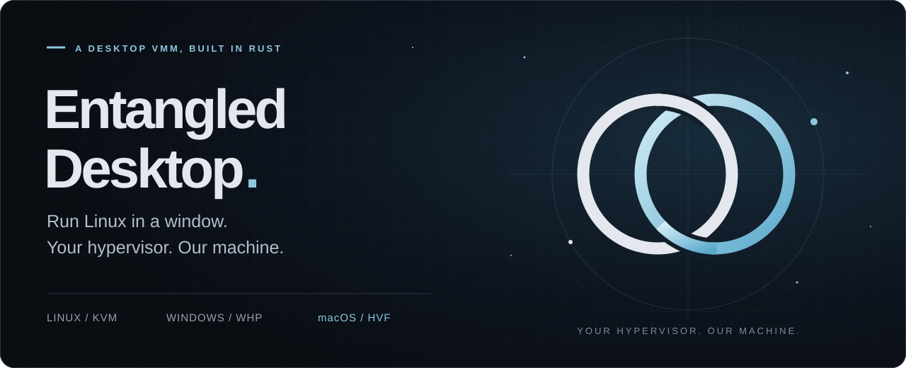
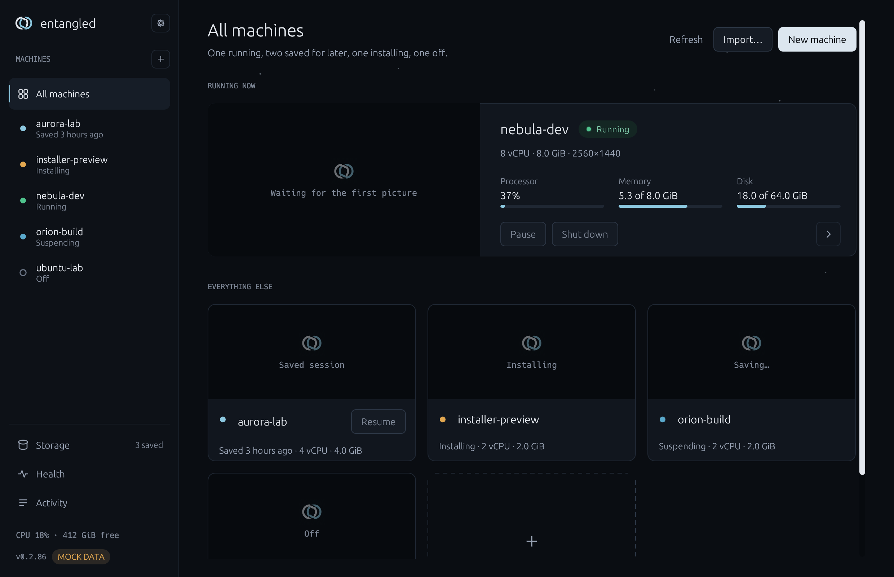
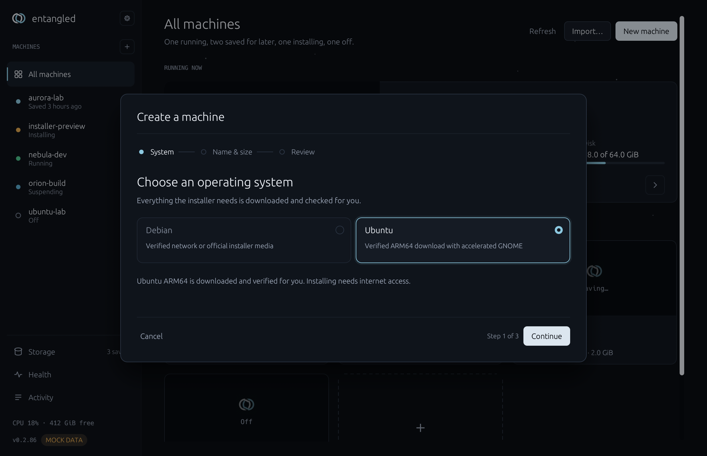
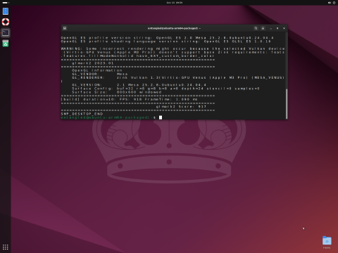
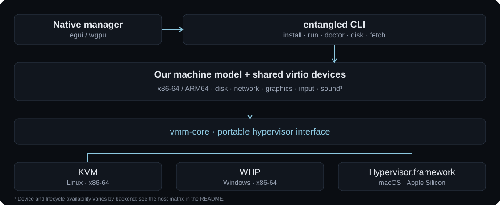

<p align="center">
  
</p>

<h1 align="center">Linux, in your orbit.</h1>

<p align="center">
  A desktop virtual machine monitor written in <strong>Rust</strong>.<br>
  Native hypervisors. Our own device models.
</p>

<p align="center">
  <a href="https://github.com/doctorspider42/entangled-destop/actions/workflows/ci.yml"></a>
  <a href="LICENSE"></a>
  <a href="#hosts"></a>
  <a href="docs/adr/0007-macos-arm64.md"></a>
</p>

<p align="center">
  <a href="https://github.com/doctorspider42/entangled-destop/releases"><strong>Download</strong></a> ·
  <a href="#get-started">Get started</a> ·
  <a href="docs/user-guide.md">User guide</a> ·
  <a href="docs/adr/">Architecture</a> ·
  <a href="docs/troubleshooting.md">Troubleshooting</a>
</p>

---

Entangled Desktop installs Linux, gives it a disk, network, graphics and input,
and puts it in a window on your desktop. Use the native manager or drive the
same machine from the CLI. Debian, Ubuntu and Fedora installations are
unattended, using verified media; Apple Silicon installs Ubuntu ARM64.

Underneath is a VMM built on **KVM**, **Windows Hypervisor Platform**, and
**Hypervisor.framework**. The virtio device implementations,
x86 interrupt controllers, ACPI tables and PCI bus live here in Rust.

## A look inside

<a href="docs/media/manager.png"></a>

<p align="center"><sub>The actual native manager, captured on macOS. Machine states and resource meters are <strong>demo data</strong> from <code>--mock</code>; this image demonstrates the UI, not macOS lifecycle support.</sub></p>

<table>
  <tr>
    <td width="50%" valign="top">
      <a href="docs/media/create-machine.png"></a>
      <br><strong>Choose a system. Make it yours.</strong><br>
      The native creation wizard handles downloads and verification. Actual UI, captured with demo data on macOS.
    </td>
    <td width="50%" valign="top">
      <a href="docs/media/ubuntu-venus.png"></a>
      <br><strong>A real guest, on real hardware.</strong><br>
      Ubuntu ARM64 on Apple M3 Pro. Guest OpenGL through Zink/Venus; captured during a selected glmark2 scene test. OpenGL 2.1 limits apply.
    </td>
  </tr>
</table>

[Capture details and reproduction](docs/media/README.md) · [Apple Silicon implementation and acceptance evidence](docs/adr/0007-macos-arm64.md)

## Built for the whole desktop

- **From verified media to a bootable machine.** Unattended Debian, Ubuntu Server,
  Ubuntu Desktop and Fedora Workstation installs on Linux/Windows. Persistent
  UEFI variables keep the guest's boot entry between runs.
- **Graphics that reach the host GPU.** Vulkan through Venus, OpenGL through
  Mesa Zink, and VirGL on Linux. The installer can configure the GPU desktop
  with `--venus`; `entangled doctor` checks host requirements.
- **A machine you can put down and pick up.** Pause, resume, reboot in place,
  or suspend to a file and restore in a new process on Linux/Windows.
- **Networking without the ceremony.** User-mode NAT needs no administrator
  privileges or host network setup. Linux also supports TAP.
- **Files you can understand.** TOML profiles, sparse RAW disks, explicit NVRAM
  sidecars and a CLI for inspecting, growing and moving disks.
- **One core, native hosts.** Shared device code behind a portable hypervisor
  interface; a native egui/wgpu manager launches each VM as its own process.

## Hosts

| | Linux | Windows | macOS |
|---|---|---|---|
| Host CPU | x86-64 | x86-64 | Apple Silicon |
| Hypervisor | KVM | WHP, native | Hypervisor.framework |
| Guest installation | Debian, Ubuntu, Fedora | Debian, Ubuntu, Fedora | Ubuntu ARM64 |
| Boot | UEFI or direct Linux | UEFI or direct Linux | Direct Linux |
| Graphics | 2D, Venus/Zink, VirGL | 2D, Venus/Zink | Venus/Zink |
| Networking | User-mode NAT, TAP | User-mode NAT | User-mode NAT |
| Audio playback | ALSA | WASAPI | Not connected |
| Pause / reboot / suspend to file | Implemented | Implemented | Not connected |

**Apple Silicon requires macOS 26+.**
SMP supports 1–64 vCPUs within the host hypervisor limit. Vulkan 1.3 and Zink
OpenGL 2.1 have been verified on Apple M3 Pro; presentation currently copies
pixels. ARM ISO/UEFI boot is not connected and longer stability testing remains
in progress. See [ADR-0007](docs/adr/0007-macos-arm64.md).

## Get started

### macOS · Apple Silicon

Download the ARM64 **DMG** from [Releases](https://github.com/doctorspider42/entangled-destop/releases),
drag **Entangled Desktop** into Applications, then open the manager and choose
**New machine → Ubuntu**. The wizard downloads verified ARM64 media and installs
GNOME with hardware graphics. The Vulkan runtime is bundled; no global SDK is needed.

Current release packaging signs with Developer ID, notarizes the DMG and staples
Apple's ticket; a SHA-256 file accompanies it. Earlier manually attached previews
may be signed without notarization — check their release notes.
[Packaging and signing details](installer/macos/README.md).

<details>
<summary>Prefer the CLI? Create an Ubuntu ARM64 machine.</summary>

From a shell where `entangled` is available:

```bash
entangled doctor
entangled install ubuntu --auto --disk ubuntu.raw --size 8G --memory-mib 4096
entangled run ubuntu.toml
```

New Apple Silicon machines use all available host cores by default. Choose fewer
with `--vcpus` or in the wizard. Leave more disk space for a machine you plan to keep.

</details>

### Windows · x86-64

Download `entangled-desktop-<version>-setup.exe` from
[Releases](https://github.com/doctorspider42/entangled-destop/releases).
Enable the **Windows Hypervisor Platform** optional feature and reboot, then
open the manager and choose **New machine**.

**Windows releases are unsigned and have no published checksums.** SmartScreen
will warn. You can build from source instead. The installer does not add the CLI
to `PATH`; the manager finds it automatically.
[Windows installation details](docs/user-guide.md#windows-the-installer-from-github-releases).

### Linux · x86-64

With a current stable Rust toolchain and this repository checked out:

```bash
sudo apt-get install -y build-essential pkg-config curl
cargo build --workspace --release
export PATH="$PWD/target/release:$PATH"
entangled fetch firmware
sudo usermod -aG kvm "$USER"  # log out and back in before running a VM
```

If you set `CARGO_TARGET_DIR`, use its `release` directory in `PATH` instead.
You need access to `/dev/kvm` and a graphical session for windowed VMs.
Launch `entangled-manager` for the wizard, or use the CLI below.
[Runtime and optional packages](docs/user-guide.md#getting-the-software).

<details>
<summary>CLI quickstart: an Ubuntu desktop on Linux</summary>

Fetch the verified Desktop ISO, install, then boot the generated profile:

```bash
entangled doctor
mkdir -p ~/entangled-vms
iso=$(bash scripts/fetch-ubuntu-iso.sh desktop)
entangled install ubuntu --iso "$iso" --disk ~/entangled-vms/desktop.raw \
  --size 40G --memory-mib 4096 --auto --headless
entangled run ~/entangled-vms/desktop.toml
```

For hardware graphics, add `--venus` to the install command after `doctor`
confirms your host GPU qualifies. Keep `desktop.nvram` beside the disk: it holds
the UEFI boot entry. The built-in installer creates the demo login
**`entangled` / `entangled`**; change the password with `passwd` for a VM you keep.

[Ubuntu and GPU setup](docs/user-guide.md#quickstart-ubuntu-server) ·
[Fedora](docs/user-guide.md#quickstart-fedora-workstation) ·
[Debian](docs/user-guide.md#quickstart-debian)

</details>

## Under the hood



The core uses rust-vmm crates for checked guest-memory access and virtqueues.
Devices are independent of their transport: the x86 platform offers virtio-mmio
and virtio-pci with MSI-X; the ARM platform uses virtio-mmio. The x86 UEFI firmware
is an unmodified EDK2 `CloudHv` build from pinned sources.

| Explore | Start here |
|---|---|
| Hypervisor abstraction and CPU lifecycle | [`vmm-core`](crates/vmm-core), [portability ADR](docs/adr/0002-linux-first-whp-ready.md) |
| Machine platforms | [`machine-x86`](crates/machine-x86), [`machine-arm64`](crates/machine-arm64) |
| Devices and graphics | [`virtio-core`](crates/virtio-core), [`virtio-gpu`](crates/virtio-gpu), [graphics ADR](docs/adr/0004-virtio-gpu-3d.md) |
| Freeze, reset, save, restore | [Lifecycle ADR](docs/adr/0005-vm-lifecycle.md), [snapshot ADR](docs/adr/0006-suspend-restore.md) |
| Native manager and CLI | [`apps/manager`](apps/manager), [`apps/entangled`](apps/entangled) |

## Current boundaries

Linux guests are the tested path; assume Windows guests do not work. There is
no USB or PCI passthrough, live migration, clustering or server daemon.
Anti-cheat games will not run. GPU support depends on the host driver and guest
configuration; a successful selected graphics test is not a general game or
performance guarantee. macOS has the additional gaps listed above.

[All limits in one place](docs/user-guide.md#limits-in-one-place) ·
[Known failures and fixes](docs/troubleshooting.md)

## Build with us

Start with [CLAUDE.md](CLAUDE.md) for the workspace map, architecture and hard
rules, and [AGENTS.md](AGENTS.md) for Codex instructions. Subsystem guides live in
[`.agents/skills/`](.agents/skills/) and [`.claude/skills/`](.claude/skills/).
Load `dev-environment` before building or launching a demo VM.

```bash
cargo test --workspace
cargo clippy --workspace --all-targets -- -D warnings
cargo fmt --all --check
cargo deny check
```

Hardware tests self-skip when the required hypervisor or guest artifacts are
missing; a green CI run alone does not prove a guest booted. The architecture
records and acceptance notes describe what was exercised on real hosts.

Bug reports are most useful with the host OS, `entangled doctor` output and the
relevant install/run log. Please remove credentials and private paths before
sharing. The [product backlog](vmhost-mvp-backlog.md) is in Polish.

## License

[Apache-2.0](LICENSE). Host dependencies are audited in CI with `cargo deny` to
exclude GPL/AGPL/LGPL licenses. Guest-side components have their own licenses;
the published Debian bootstrap kernel is GPL-2.0-only with corresponding source,
and its download is checked against a SHA-256 pinned in the binary.
